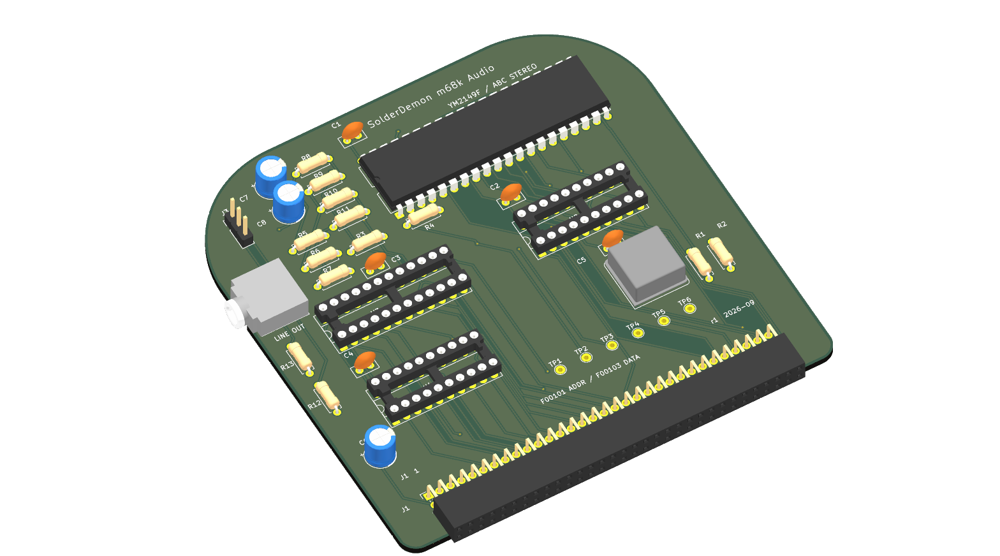

# SolderDemon m68k Audio Board

A SolderDemon Yamaha YM2149F programmable sound generator (PSG) expansion card for SolderDemon m68k. Compatible with the [rosco_m68k](https://github.com/rosco-m68k/rosco_m68k) ecosystem.

Designed as a vertical daughterboard for the [SolderDemon m68k bus board](../solderdemon_m68k-busboard), it equips the system with three square-wave tone channels, a hardware noise generator, and an envelope generator. An onboard hardware sequencer implemented in an ATF22V10C PLD couples the fast MC68010 bus to the slow Yamaha PSG by managing strobe timing, data latching, and automatic `~DTACK` cycle termination. Audio is output through a passive ABC stereo mixer to an onboard 3.5 mm jack and a line header.



---

## Highlights

- **Sound Generator:** Yamaha **YM2149F** (`U1`, DIP-40): 3 tone channels (A, B, C), noise generator, and hardware envelope generator, clocked from a dedicated **1.8432 MHz 5 V oscillator** (`X1`, DIP-8).
- **Hardware-Timed Bus Interface:** The slow PSG never sees the fast MC68010 bus cycles directly. An intermediate octal latch (**CD74HCT273E**, `U2`) captures bus data (`D0`–`D7`), while an **ATF22V10C-15PU** PLD (`U3`) sequences `BDIR` strobes and asserts `~DTACK` when the write cycle finishes.
- **Address Decoding:** High-speed address decoding via **CD74HCT688E** (`U4`) magnitude comparator matching `A8`–`A15` against `$01`, combined with PLD qualification of `~IOSEL`, `~AS`, `~LDS`, `R/~W`, and `A16`–`A19` for the `$F00100`–`$F001FF` address block.
- **Zero Software Timing Loops:** Write cycles automatically insert CPU wait states until hardware asserts `~DTACK`. The CPU performs straightforward byte writes to register and data addresses at full speed without needing software delays or timers.
- **Bus Safety:** `BC1` is tied to GND and the hardware only accepts write cycles. Read cycles and PSG GPIO directions are physically excluded, eliminating any possibility of bus contention.
- **Passive ABC Stereo:** 1 kΩ channel loads and a resistive mixer: Channel A to left, Channel C to right, Channel B centered in both channels at −6.9 dB, followed by 10 µF AC coupling (`C7`/`C8`) and 100 kΩ DC bleeders.
- **Dual Outputs:** Front/side 3.5 mm TRS stereo jack **CUI SJ1-3525N** (`J2`) and an internal 1×3 vertical header (`J3`: L / GND / R) for case or mixer wiring.
- **Test Points:** 6 dedicated probe points (`TP1`–`TP6`) for oscilloscope/logic analyzer timing verification (GND, CAPTURE, BDIR, A1, DTACK, PSGCLK).
- **Busboard Form Factor:** 100 × 100 mm 2-layer PCB, R25 mm top corners and R4 mm bottom corners. Plugs vertically into any 2×32 Eurocard bus slot (`J1`).
- **100% Through-Hole (THT):** All ICs socketed in standard DIP packages, axial/radial passive components for straightforward DIY assembly.

---

## Memory Map

The card is mapped into the SolderDemon m68k I/O region (`$F00000`–`$FFFFFF`), specifically claiming the 256-byte page `$F00100`–`$F001FF`. Because the YM2149 is an 8-bit peripheral wired to the lower data byte (`D0`–`D7`), all accesses must be byte writes with the Lower Data Strobe (`LDS`) asserted (odd addresses).

| Address | Mode | Function | Bus Lines |
|---|---|---|---|
| **`$F00101`** | Write-only (byte) | **PSG Register Address Latch** | `A1` = 0 (`BC2` = 0, `BDIR` pulsed high) |
| **`$F00103`** | Write-only (byte) | **PSG Data Value Write** | `A1` = 1 (`BC2` = 1, `BDIR` pulsed high) |
| **`$F00100`–`$F001FF`** | — | Mirrors of the above registers (`A2`–`A7` ignored) | Treat full `$F00100`–`$F001FF` page as occupied |

> **Note:** Only byte writes with `LDS` asserted are decoded and acknowledged. Word writes, long-word writes, upper-byte writes (`UDS`), and read cycles are ignored and will result in a CPU bus timeout / bus error if attempted.

### Hardware-Timed Interface

The YM2149F bus control lines are `BDIR`, `BC1`, and `BC2`. This card ties `BC1` to ground, uses `BC2` driven by address line `A1`, and controls `BDIR` via the PLD sequencer:

| `BC2` (`A1`) | `BDIR` (PLD) | PSG Function |
|:---:|:---:|:---|
| `0` | `0` | Inactive |
| `0` | `1` | **Latch Register Address** (data from latch `U2` selected into address register) |
| `1` | `0` | Inactive |
| `1` | `1` | **Write Data to Register** (data from latch `U2` written to selected register) |

---

## Operating Principle

1. **Address Match & Qualification:** When the MC68010 initiates an I/O cycle with `~IOSEL`, `~AS`, `~LDS`, and write (`R/~W` low), `U4` (74HCT688) verifies that `A8`–`A15` equals `$01`. `U3` confirms that `A16`–`A19` are zero, asserting internal request `~NREQ`.
2. **Data Capture:** On the second sequencer clock (`S2`), `U3` generates a clock pulse to `U2` (`74HCT273`), latching the write data from bus lines `D0`–`D7`.
3. **Strobe Generation:** On state `S3`, `U3` asserts `BDIR` high to the PSG. It maintains `BDIR` asserted until state `S5`, providing a clean, jitter-free strobe of ~1.08 µs (well within the YM2149 requirement of 300 ns to 10 µs).
4. **Bus Cycle Acknowledgment:** On state `S6`, `U3` pulls the open-collector `~DTACK` line low, signaling to the CPU that the bus cycle is complete. The CPU terminates the write cycle and releases the bus.

---

## Programming Example

### C Interface (`solderdemon_audio.h`)

```c
#include "solderdemon_audio.h"

void play_sound(void) {
    /* Set mixer: Tone A enabled, Noise disabled */
    sd_psg_write(7, 0x3E);

    /* Set Channel A period (e.g. middle C at 1.8432 MHz PSG clock) */
    sd_psg_write(0, 0xDC); /* Coarse */
    sd_psg_write(1, 0x01); /* Fine */

    /* Set Channel A volume to maximum (15) */
    sd_psg_write(8, 15);

    /* ... playback delay ... */

    /* Silence all voices */
    sd_psg_silence();
}
```

### M68K Assembly (`demo.s`)

```asm
    .equ PSG_ADDR, 0x00f00101
    .equ PSG_DATA, 0x00f00103

/* D0.b = register 0..13, D1.b = value.
 * Disables interrupts during register/data pair write.
 */
psg_write:
    cmpi.b  #13,%d0
    bhi     3f
    move.w  %sr,-(%sp)
    ori.w   #0x0700,%sr     /* Inhibit interrupts */
    move.b  %d0,PSG_ADDR    /* Latch register number */
    move.b  %d1,PSG_DATA    /* Write register value */
    move.w  (%sp)+,%sr      /* Restore interrupt level */
3:  rts

psg_silence:
    movem.l %d0-%d1,-(%sp)
    moveq   #0,%d1
    moveq   #8,%d0
    bsr     psg_write       /* Volume A = 0 */
    moveq   #9,%d0
    bsr     psg_write       /* Volume B = 0 */
    moveq   #10,%d0
    bsr     psg_write       /* Volume C = 0 */
    movem.l (%sp)+,%d0-%d1
    rts
```

### Building Code & PLD

```sh
# Assemble the test demo with m68k-elf toolchain
m68k-elf-gcc -m68000 -nostdlib -T code/demo/demo.ld code/demo/demo.s -o code/demo/demo.elf
m68k-elf-objcopy -O binary code/demo/demo.elf code/demo/demo.bin

# Compile PLD equations
galasm code/pld/audio_sequencer.pld
```

---

## Bill of Materials (BOM)

| Reference | Value | Package / Footprint | Notes |
|---|---|---|---|
| **U1** | YM2149F | DIP-40, 15.24 mm (0.6") | Yamaha Sound Generator (PSG). Socket recommended. |
| **U2** | CD74HCT273E | DIP-20, 7.62 mm (0.3") | Octal D-type flip-flop with clear. Socket recommended. |
| **U3** | ATF22V10C-15PU | DIP-24, 7.62 mm (0.3") | PLD Write Sequencer / DTACK generator (-15 speed grade). |
| **U4** | CD74HCT688E | DIP-20, 7.62 mm (0.3") | 8-bit magnitude identity comparator. Socket recommended. |
| **X1** | 1.8432 MHz / 5V | DIP-8 (half-can) | Dedicated 5V crystal oscillator module (50 ppm). |
| **J1** | 2×32 Pin Socket | 2.54 mm, R/A Horizontal | Eurocard backplane connector. |
| **J2** | SJ1-3525N | 3.5 mm TRS Jack, Horizontal | CUI Devices horizontal stereo audio jack. |
| **J3** | 1×03 Pin Header | 2.54 mm, Vertical | Line out header: Pin 1 = Left, Pin 2 = GND, Pin 3 = Right. |
| **R1, R2** | 33 Ω | Axial DIN0207, P7.62 mm | Series damping resistors for clock lines. |
| **R3, R4** | 10 kΩ | Axial DIN0207, P7.62 mm | Logic pull-up resistors. |
| **R5–R7** | 1 kΩ | Axial DIN0207, P7.62 mm | PSG audio channel A/B/C load resistors (1% preferred). |
| **R8, R11** | 10 kΩ | Axial DIN0207, P7.62 mm | Channel A → Left, Channel C → Right mixer resistors. |
| **R9, R10** | 22 kΩ | Axial DIN0207, P7.62 mm | Channel B → Left & Right center mix (−6.9 dB). |
| **R12, R13** | 100 kΩ | Axial DIN0207, P7.62 mm | Output DC bleeder resistors. |
| **C1–C5** | 100 nF | Disc / Ceramic, P2.5 mm | Decoupling capacitors (one per IC and oscillator). |
| **C6** | 47 µF / 16V | Radial D6.3 mm, P2.5 mm | Bulk electrolytic reservoir capacitor near bus power pins. |
| **C7, C8** | 10 µF / 16V | Radial D6.3 mm, P2.5 mm | AC coupling electrolytic capacitors (+ terminal toward mixer). |
| **TP1–TP6** | Test Point Pads | THT Pad D2.0 mm, Drill 1.0 mm | Oscilloscope test points: GND, CAPTURE, BDIR, A1, DTACK, PSGCLK. |

> **Height & Sockets:** Use low-profile DIP sockets (one DIP-40, one DIP-24, two DIP-20, one DIP-8) and low-profile radial capacitors to ensure clearance within the standard 20.32 mm (0.8") Eurocard backplane slot pitch.

---

## Timing Budget & Sequencer States

Clocked by the 1.8432 MHz oscillator ($T_{clk} \approx 542.5\text{ ns}$), the ATF22V10C sequencer (`S0`–`S6`) executes the following cycle:

```text
State:    Idle    S0      S1      S2      S3      S4      S5      S6     Idle
Clock:    __|~~~|___|~~~|___|~~~|___|~~~|___|~~~|___|~~~|___|~~~|___|~~~|___|~~~
~NREQ:    ~~~~~~\________________________________________________/~~~~~~~~~~~
U2 Latch: ------------------------| LATCH |-----------------------------------
BDIR:     ________________________________|~~~~~~~~~~~~~~~~~~~~~~~|___________
~DTACK:   ~~~~~~~~~~~~~~~~~~~~~~~~~~~~~~~~~~~~~~~~~~~~~~~~~~~~~~~~|_______|~~~
```

- **Setup Time ($S_0 \to S_2$):** Data setup prior to strobe assertion is $\ge 414.5\text{ ns}$ (datasheet requires $\ge 300\text{ ns}$).
- **Strobe Width ($S_3 \to S_5$):** `BDIR` is asserted for 2 full clock cycles ($1005.0\text{ ns}$ to $1165.1\text{ ns}$), well within the Yamaha spec ($300\text{ ns} \le t_W \le 10000\text{ ns}$).
- **Hold Time ($S_5 \to S_6$):** Post-strobe data and address hold time is $\ge 444.5\text{ ns}$ (datasheet requires $\ge 80\text{ ns}$).
- **DTACK Assertion ($S_6$):** `DTACK` asserts on state `S6`. The CPU samples `DTACK` and terminates the bus cycle, safely causing `~NREQ` to deassert and resetting the sequencer asynchronously (`AR = NREQ`).

---

## PLD Firmware (U3)

The write sequencer logic is defined in [`code/pld/audio_sequencer.pld`](code/pld/audio_sequencer.pld) (GALasm) and pre-assembled into `code/pld/audio_sequencer.jed`:

```text
/NREQ = /IOSEL * /MATCH * /AS * /LDS * /RW * RESET * /A16 * /A17 * /A18 * /A19
AR = NREQ
S0.R = /NREQ
S1.R = S0
S2.R = S1
S3.R = S2
S4.R = S3
S5.R = S4
S6.R = S5
BDIR = S3 * /S5 * /NREQ
DTACK.T = GND
DTACK.E = S6 * /NREQ
```

### Programming the ATF22V10C

Flash the `.jed` file using an EEPROM/PLD programmer (such as the Minipro TL866II+ / T48):

```sh
galasm code/pld/audio_sequencer.pld
minipro -p ATF22V10C -w code/pld/audio_sequencer.jed
```

> [!IMPORTANT]
> Ensure the programmer is configured for **ATF22V10C** mode with the power-down option disabled. Do not substitute with an ATF16V8 or generic GAL22V10 without rebuilding the fuse map.

---

## First Power-Up & Testing

1. **Visual & Continuity Inspection:**
   - Verify polarity of electrolytic capacitors `C6`, `C7`, and `C8` (`+` marks).
   - Verify notch and Pin 1 orientation for all IC sockets (`U1`–`U4`) and oscillator `X1`.
   - With ICs unpopulated, plug into a powered-off backplane and verify +5 V on power pins and 0 Ω to GND on ground pins. Ensure no VCC-to-GND shorts exist.
2. **PLD & Clock Verification:**
   - Insert `X1` and `U3` (programmed ATF22V10C). Power on the board.
   - Probe `TP6` (`PSGCLK`) with an oscilloscope to confirm a clean 1.8432 MHz square wave.
3. **Logic & PSG Installation:**
   - Power off, install `U4` (74HCT688), `U2` (74HCT273), and `U1` (YM2149F).
   - Connect active/powered speakers or an amplifier line input to `J2` (3.5 mm jack). **Do not connect passive speakers or low-impedance headphones directly** (this is a line-level output).
4. **Running the Demo:**
   - Load `code/demo/demo.bin` into memory at `0x00040000` via the SolderDemon m68k serial bootloader.
   - Execute the code. You should hear a clear C-major triad played across channels A, B, and C for approximately 1 second, followed by clean silence.
   - Verify with an oscilloscope that `TP3` (`BDIR`) and `TP5` (`DTACK`) pulse during each register access.

---

## Manufacturing & Hardware Files

- **KiCad Project:** `solderdemon_m68k-audio.kicad_pro`, `solderdemon_m68k-audio.kicad_sch`, `solderdemon_m68k-audio.kicad_pcb` (KiCad 8/9/10 format)
- **Symbol Library:** `SolderDemonAudio.kicad_sym`
- **Schematic PDF:** [`solderdemon_m68k-audio.pdf`](solderdemon_m68k-audio.pdf)
- **Bill of Materials:** [`BOM.csv`](BOM.csv)
- **Automated Verification:**
  - `python tools/verify_design.py`: Full pin connectivity, 65,536 address pages, JEDEC fuse validation.
  - `tools/verify_demo.c`: Musashi MC68010 execution test validating 40 atomic MMIO writes and register preservation.

---

## Sources & References

- [Yamaha YM2149 Programmable Sound Generator Datasheet](docs/reference/ym2149.pdf)
- [Microchip ATF22V10C High-Performance EE PLD Datasheet](docs/reference/atf22v10c.pdf)
- [Texas Instruments CD74HCT273 Octal D-Type Flip-Flop Datasheet](docs/reference/cd74hct273.pdf)
- [Texas Instruments CD74HCT688 8-Bit Magnitude Comparator Datasheet](docs/reference/cd74hct688.pdf)

---

## License

- **Hardware:** CERN Open Hardware Licence Version 2 — Strongly Reciprocal ([CERN-OHL-S v2](LICENCE.hardware.txt)).
- **Code** (sequencer PLD, driver, demo, verification tools): [MIT License](LICENSE.code).
